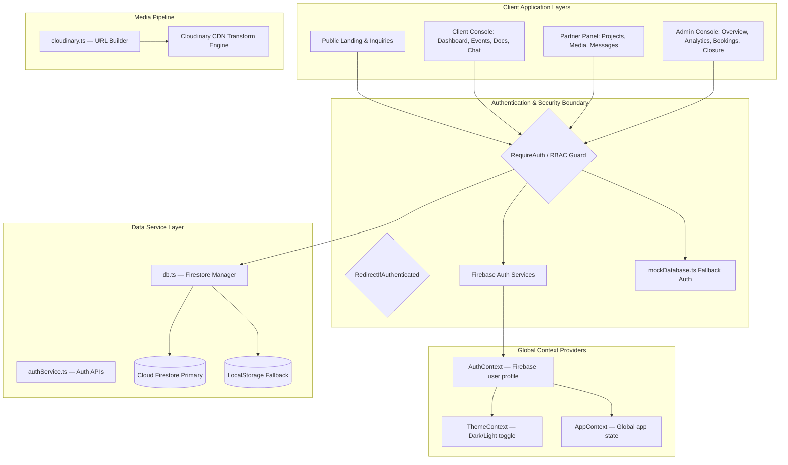

# Gowtham Events

> An event-management interface combining interactive 3D storytelling with admin, client, and partner workspaces.

**React · TypeScript · Vite · Three.js · Firebase**

## At a glance

- A public-facing experience with scroll-driven scenes and reusable UI.
- Dedicated layouts and screens for three authenticated roles.
- Booking, gallery, messaging, and project-management interfaces.

## Explore the implementation

| Start here | What to inspect |
| --- | --- |
| [src/journey](src/journey) | Interactive scene composition |
| [src/components](src/components) | Reusable UI and 3D components |
| [src/pages](src/pages) | Role-specific screens |
| [src/auth](src/auth) | Authentication and route guards |
| [src/data](src/data) | Data-access layer |

The payment and some partner routes remain placeholders. The client-side admin access code is a demo gate, not a server-enforced authorization boundary.

---

## Detailed guide

**Gowtham Events** is a  **Event Management & Coordinating Company Web Application** built with React 18, TypeScript, Vite, WebGL (Three.js / React-Three-Fiber), and Firebase. It features advanced 3D shaders, real physically-based materials, scroll-choreographed camera dolly pipelines, real-time Firestore sync pipelines, Cloudinary media optimization, and a full multi-role authentication system.

> **Current status:** Active development. Known placeholder routes are listed below.

---

## 🏗️ System Architecture



---

## 🛠️ Technology Stack

| Category | Technology | Version |
| :--- | :--- | :--- |
| **Runtime** | React | ^18.3.1 |
| **Language** | TypeScript | ~5.3.3 |
| **Build Tool** | Vite | ^5.1.4 |
| **Styling** | Tailwind CSS v4 + Vanilla CSS Variables | ^4.0.0 |
| **Routing** | React Router DOM | ^6.22.3 |
| **Animations** | Framer Motion | ^11.0.8 |
| **Smooth Scroll** | Lenis | ^1.0.42 |
| **GSAP** | GSAP (animations) | ^3.12.5 |
| **Auth & DB** | Firebase (Auth + Firestore) | ^12.16.0 |
| **Forms** | React Hook Form + Zod Validation | ^7.82.0 / ^4.4.3 |
| **Toasts** | React Hot Toast | ^2.6.0 |
| **Icons** | React Icons (Fi pack) | ^5.0.1 |
| **Slider** | Swiper.js | ^11.0.7 |
| **Media CDN** | Cloudinary CDN URL Parameters | — |
| **Linter** | OxLint | ^1.0.0 |

---

## 📂 Complete Folder Structure

```text
event-management/
├── .env                           # Environment variables (Firebase keys, Admin access code)
├── .gitignore
├── .oxlintrc.json                 # OxLint configuration
├── index.html                     # Root HTML entry point
├── package.json
├── tsconfig.json / tsconfig.app.json / tsconfig.node.json
├── vite.config.ts                 # Vite + Tailwind CSS v4 plugin config
│
└── src/
    ├── App.tsx                    # Root router — all routes defined here
    ├── main.tsx                   # React DOM entry mount
    ├── App.css                    # Global app CSS overrides
    ├── index.css                  # CSS design tokens, variables, base styles
    │
    ├── auth/                      # 🔐 Security, Guards & Auth Portals
    │   ├── context/
    │   │   └── AuthContext.tsx    # Firebase user session, role state
    │   ├── guards/
    │   │   ├── RequireAuth.tsx    # RBAC guard — redirects unauthorized users
    │   │   └── RedirectIfAuthenticated.tsx  # Blocks auth pages when logged in
    │   ├── pages/
    │   │   ├── Login.tsx          # Unified login form (all roles)
    │   │   ├── RegisterClient.tsx # Client self-registration
    │   │   ├── RegisterAdmin.tsx  # Admin registration (requires access code)
    │   │   ├── ForgotPassword.tsx # Password reset flow
    │   │   └── Unauthorized.tsx   # 403 access denied page / 404 catch-all
    │   ├── services/
    │   │   ├── firebase.ts        # Firebase SDK initialization
    │   │   ├── authService.ts     # Auth APIs (login, register, logout, reset)
    │   │   └── mockDatabase.ts    # Offline mock auth fallback data
    │   └── utils/                 # Auth utility helpers
    │
    ├── components/                # 🧩 Shared Premium UI Components
    │   ├── Navbar.tsx             # Responsive top navigation bar
    │   ├── Footer.tsx             # Site-wide footer with links & socials
    │   ├── Button.tsx             # Reusable CTA button component
    │   ├── Loader.tsx             # Loading spinner overlay
    │   ├── Lightbox.tsx           # Full-screen media lightbox slider
    │   ├── SectionTitle.tsx       # Styled section heading component
    │   ├── StatCounter.tsx        # Animated statistics counter
    │   ├── Timeline.tsx           # Visual timeline component
    │   ├── ScrollProgress.tsx     # Scroll progress indicator bar
    │   └── BackToTop.tsx          # Floating back-to-top button
    │
    ├── context/                   # 🌐 Global Context Providers
    │   ├── ThemeContext.tsx       # Dark / Light mode toggle state
    │   └── AppContext.tsx         # App-wide global state context
    │
    ├── data/                      # 💾 Primary Database Layer
    │   ├── db.ts                  # Firestore service (CRUD + LocalStorage fallback)
    │   └── mockData.ts            # Seed data for offline/demo mode
    │
    ├── hooks/                     # 🪝 Custom React Hooks
    │   └── useSEO.ts              # Dynamic <title> & <meta> SEO injection hook
    │
    ├── layouts/                   # 🏛️ Navigation Shell Wrappers
    │   ├── PublicLayout.tsx       # Navbar + Footer wrapper for public pages
    │   ├── AdminLayout.tsx        # Admin sidebar shell
    │   ├── ClientLayout.tsx       # Client sidebar shell
    │   ├── PartnerLayout.tsx      # Partner sidebar shell
    │   └── DashboardShell.tsx     # Glassmorphic sidebar base component (shared)
    │
    ├── pages/                     # 📄 All Portal Page Modules
    │   ├── public/                # Public-facing website pages
    │   │   ├── Home.tsx           # Landing hero, services, stats, testimonials
    │   │   ├── About.tsx          # Company history, team, values, mission
    │   │   ├── Services.tsx       # Services catalog with features
    │   │   ├── Portfolio.tsx      # Past projects showcase with Swiper
    │   │   ├── Gallery.tsx        # Image gallery with Lightbox viewer
    │   │   ├── UpcomingEvents.tsx # Upcoming events listing with countdown
    │   │   └── Contact.tsx        # Inquiry form with booking submission
    │   │
    │   ├── admin/                 # Admin Console (role: admin)
    │   │   ├── Overview.tsx       # KPI summary cards & recent activity feed
    │   │   ├── Analytics.tsx      # SVG interactive charts & revenue analytics
    │   │   ├── Bookings.tsx       # Booking management (approve/reject/convert)
    │   │   ├── Events.tsx         # Event scheduling & management
    │   │   ├── Clients.tsx        # Client accounts management panel
    │   │   ├── Partners.tsx       # Partner accounts (activate/suspend)
    │   │   ├── Portfolio.tsx      # Portfolio projects editor (add/edit/delete)
    │   │   ├── Gallery.tsx        # Gallery image management
    │   │   ├── Media.tsx          # Media asset browser (Cloudinary-linked)
    │   │   ├── Closure.tsx        # Project closure reports & CSV exports
    │   │   └── Settings.tsx       # Company info editor (tagline, contact, socials)
    │   │
    │   ├── client/                # Client Console (role: client)
    │   │   ├── Dashboard.tsx      # Event milestones, countdown timers, overview
    │   │   ├── Events.tsx         # Client's assigned events tracker
    │   │   ├── Documents.tsx      # Quotation / contract downloads & sign-offs
    │   │   ├── Gallery.tsx        # Project gallery viewer (read-only)
    │   │   ├── Messages.tsx       # Direct messaging with coordinator + search
    │   │   └── Profile.tsx        # Client profile editor
    │   │
    │   ├── partner/               # Partner Panel (role: partner)
    │   │   ├── Dashboard.tsx      # Task summary, upcoming deadlines overview
    │   │   ├── Projects.tsx       # Assigned projects & task checklist workspace
    │   │   ├── Media.tsx          # Proof-of-work image uploads (Cloudinary)
    │   │   ├── Messages.tsx       # Partner ↔ Admin messaging
    │   │   └── Profile.tsx        # Partner profile editor
    │   │
    │   └── dashboard/             # Placeholder pages (legacy routes)
    │       └── PlaceholderPages.tsx  # AdminPayments, PartnerReports, PartnerPayments, PartnerDocuments
    │
    ├── types/
    │   └── index.ts               # Global TypeScript interfaces
    │
    └── utils/
        └── cloudinary.ts          # Cloudinary URL builder (f_auto, q_auto, resize)
```

---

## 🗺️ Route Map

### Public Routes (No Auth Required)

| Route | Component | Description |
| :--- | :--- | :--- |
| `/` | `Home` | Landing page — hero, services, stats, testimonials, CTA |
| `/about` | `About` | Company profile, team, mission, values |
| `/services` | `Services` | Service catalog |
| `/portfolio` | `Portfolio` | Past event showcases |
| `/gallery` | `Gallery` | Photo gallery with Lightbox |
| `/upcoming-events` | `UpcomingEvents` | Upcoming events with countdowns |
| `/contact` | `Contact` | Inquiry & booking submission form |

### Auth Routes (Redirect if already logged in)

| Route | Component | Description |
| :--- | :--- | :--- |
| `/login` | `Login` | Unified login (all roles) |
| `/register/client` | `RegisterClient` | Client self-registration |
| `/register/admin` | `RegisterAdmin` | Admin registration (access code gated) |
| `/forgot-password` | `ForgotPassword` | Password reset |
| `/unauthorized` | `Unauthorized` | 403 / 404 catch-all |

### Admin Console (`/admin/*`) — Role: `admin`

| Route | Component | Description |
| :--- | :--- | :--- |
| `/admin` | `AdminOverview` | KPI cards, activity logs |
| `/admin/analytics` | `AdminAnalytics` | SVG charts, revenue dashboards |
| `/admin/bookings` | `AdminBookings` | Booking pipeline management |
| `/admin/events` | `AdminEvents` | Event scheduling |
| `/admin/clients` | `AdminClients` | Client account management |
| `/admin/partners` | `AdminPartners` | Partner status (active/suspended) |
| `/admin/portfolio` | `AdminPortfolio` | Portfolio CRUD |
| `/admin/gallery` | `AdminGallery` | Gallery image management |
| `/admin/media` | `AdminMedia` | Media asset browser |
| `/admin/reports` | `AdminClosure` | Closure reports & CSV exports |
| `/admin/settings` | `AdminSettings` | Company info & tagline editor |
| `/admin/payments` | `AdminPayments` | *(Placeholder — Phase 5)* |

### Client Console (`/client/*`) — Role: `client`

| Route | Component | Description |
| :--- | :--- | :--- |
| `/client` | `ClientDashboard` | Milestones, countdown, event overview |
| `/client/events` | `ClientEvents` | Assigned events tracker |
| `/client/documents` | `ClientDocuments` | Quotation/contract download & sign-off |
| `/client/gallery` | `ClientGallery` | Project gallery viewer |
| `/client/messages` | `ClientMessages` | Chat with coordinator |
| `/client/profile` | `ClientProfile` | Profile editor |

### Partner Panel (`/partner/*`) — Role: `partner`

| Route | Component | Description |
| :--- | :--- | :--- |
| `/partner` | `PartnerDashboard` | Task summary & deadlines |
| `/partner/projects` | `PartnerProjects` | Assigned projects & task checklist |
| `/partner/media` | `PartnerMedia` | Proof-of-work image uploads |
| `/partner/messages` | `PartnerMessages` | Partner ↔ Admin chat |
| `/partner/profile` | `PartnerProfile` | Profile editor |
| `/partner/reports` | `PartnerReports` | *(Placeholder — Phase 5)* |
| `/partner/payments` | `PartnerPayments` | *(Placeholder — Phase 5)* |
| `/partner/documents` | `PartnerDocuments` | *(Placeholder — Phase 5)* |

---

## 👥 User Roles & Permissions

| Role | Access Level | Key Capabilities |
| :--- | :--- | :--- |
| **Visitor** | Public Pages | Browse gallery, services, submit booking inquiries |
| **Client** | Client Console | View milestones, download documents, sign approvals, chat coordinator |
| **Partner** | Partner Panel | Update task checklists, upload proof images, file extension requests, chat admin |
| **Admin** | Admin Console | Full CRUD over bookings/events/partners/clients, analytics, CSV exports, closure reports, company settings |

---

## 🔒 Authentication & Sign-In Flows

1. **Client Self-Registration** — Clients fill name, email, phone; validated by Zod schema; stored in Firebase Auth + Firestore.
2. **Admin Registration** — Requires `VITE_ADMIN_ACCESS_CODE` from `.env` to prevent unauthorized admin sign-ups.
3. **Partner Approval Gate** — Partner accounts must exist in Firestore and have `status: 'active'`; admins toggle active/suspended dynamically from the Partners panel.
4. **Password Reset** — Firebase sends reset email via `ForgotPassword.tsx`.
5. **RBAC Guards:**
   - `RequireAuth` — checks Firebase session + `role` claim; redirects to `/unauthorized` on mismatch.
   - `RedirectIfAuthenticated` — prevents logged-in users from accessing auth pages; redirects by role.
6. **Offline Fallback** — `mockDatabase.ts` provides dummy credentials for testing without live Firebase.

---

## 💾 Database Schemas (Cloud Firestore)

### `users` Collection
```typescript
{
  uid: string;
  email: string;
  name: string;
  role: 'admin' | 'client' | 'partner';
  status: 'active' | 'suspended';
  phone?: string;
  createdAt: string;
}
```

### `bookings` Collection
```typescript
{
  id: string;
  name: string;
  email: string;
  phone: string;
  eventType: string;
  date: string;
  guests: number;
  status: 'pending' | 'approved' | 'rejected' | 'converted';
  createdAt: string;
}
```

### `projects` Collection
```typescript
{
  id: string;
  name: string;
  category: string;
  location: string;
  date: string;
  image: string;           // Cloudinary URL
  description: string;
  gallery: string[];       // Cloudinary URLs array
}
```

### `project_tasks` Collection
```typescript
{
  id: string;
  projectId: string;
  name: string;
  status: 'pending' | 'in_progress' | 'completed';
  deadline: string;
  extensionRequested?: boolean;
  extensionReason?: string;
  completionReportSubmitted?: boolean;
  completionReportNotes?: string;
}
```

### `project_documents` Collection
```typescript
{
  id: string;
  projectId: string;
  name: string;
  type: 'quotation' | 'plan' | 'contract';
  url: string;
  status: 'pending' | 'approved' | 'rejected';
  uploadedAt: string;
}
```

### `chat_messages` Collection
```typescript
{
  id: string;
  projectId: string;
  senderEmail: string;
  senderName: string;
  recipientEmail: string;
  message: string;
  timestamp: string;
  read: boolean;
  attachments?: {
    name: string;
    url: string;
    type: 'image' | 'file';
  }[];
}
```

### `activity_logs` Collection
```typescript
{
  id: string;
  actionType: string;
  details: string;
  timestamp: string;
}
```

---

## 🧩 Shared Components Reference

| Component | File | Purpose |
| :--- | :--- | :--- |
| `Navbar` | `components/Navbar.tsx` | Responsive top nav with mobile hamburger |
| `Footer` | `components/Footer.tsx` | Site-wide footer with social links |
| `Button` | `components/Button.tsx` | Reusable styled CTA button |
| `Loader` | `components/Loader.tsx` | Full-page loading spinner overlay |
| `Lightbox` | `components/Lightbox.tsx` | Full-screen image lightbox / slider |
| `SectionTitle` | `components/SectionTitle.tsx` | Consistent styled section headings |
| `StatCounter` | `components/StatCounter.tsx` | Animated number counters |
| `Timeline` | `components/Timeline.tsx` | Visual vertical timeline |
| `ScrollProgress` | `components/ScrollProgress.tsx` | Scroll progress indicator bar |
| `BackToTop` | `components/BackToTop.tsx` | Floating scroll-to-top FAB button |

---

## 🌐 Global Context Providers

| Context | File | Provides |
| :--- | :--- | :--- |
| `ThemeProvider` | `context/ThemeContext.tsx` | `theme` (`dark`/`light`), `toggleTheme()` |
| `AppProvider` | `context/AppContext.tsx` | App-wide global state |
| `AuthProvider` | `auth/context/AuthContext.tsx` | `user`, `userRole`, `loading`, auth methods |

**Provider wrapping order** in `App.tsx`:
```
ThemeProvider → AppProvider → AuthProvider → BrowserRouter
```

---

## 🖼️ Cloudinary Media Pipeline

The `src/utils/cloudinary.ts` utility builds optimized Cloudinary URLs:

```typescript
import { getOptimizedMediaUrl } from './utils/cloudinary';

// Auto format + quality, resize to 800x600, fill crop
const url = getOptimizedMediaUrl(rawCloudinaryUrl, {
  width: 800,
  height: 600,
  crop: 'fill',
  gravity: 'center',
  type: 'image',
});
// Produces: .../upload/f_auto,q_auto,w_800,h_600,c_fill,g_center/...
```

**Supported parameters:** `f_auto`, `q_auto`, `w_`, `h_`, `c_` (crop modes), `g_` (gravity), `vc_auto` (video codec).

> **Note:** Live Cloudinary upload API key integration is pending (Phase 5). Currently, Cloudinary URLs are stored manually in Firestore/mockData.

---

## ⚡ Setup & Run Instructions

### Prerequisites
- Node.js v18+ and npm
- Firebase project (optional — app runs with mock data if Firebase keys are omitted)

### 1. Clone & Install
```bash
git clone https://github.com/Pandiyaraj2004/Gowtham-events.git
cd Gowtham-events
npm install
```

### 2. Configure Environment Variables
Create a `.env` file in the project root:

```env
# Admin Security Access Code (required for admin registration)
VITE_ADMIN_ACCESS_CODE=replace-with-your-own-demo-code

# Firebase SDK Configuration (optional — omit to use mock data fallback)
# VITE_FIREBASE_API_KEY=your_api_key_here
# VITE_FIREBASE_AUTH_DOMAIN=your_auth_domain_here
# VITE_FIREBASE_PROJECT_ID=your_project_id_here
# VITE_FIREBASE_STORAGE_BUCKET=your_storage_bucket_here
# VITE_FIREBASE_MESSAGING_SENDER_ID=your_sender_id_here
# VITE_FIREBASE_APP_ID=your_app_id_here
```

> If Firebase keys are omitted, the app falls back to `mockDatabase.ts` for auth and `localStorage` for data persistence.

### 3. Start Development Server
```bash
npm run dev
```
Runs at `http://localhost:5173` by default.

### 4. Lint
```bash
npm run lint
```

### 5. Build Production Bundle
```bash
npm run build
```
Outputs to `dist/` — runs TypeScript compiler then Vite bundler.

### 6. Preview Production Build
```bash
npm run preview
```

---

## 🎨 Design System

- **Typography:** CSS variables with `var(--font-sans)` — modern sans-serif stack
- **Color Tokens:** `var(--bg-primary)`, `var(--bg-secondary)`, `var(--text-primary)`, `var(--border-primary)`, etc.
- **Glassmorphism:** `backdrop-filter: blur()` panels used throughout dashboard shells
- **Animations:** Framer Motion for page transitions & micro-interactions; GSAP for advanced sequences; Lenis for smooth scroll (duration: `1.1s`, custom easing)
- **Toast Style:** Glassmorphic toast — `border-radius: 16px`, themed with CSS variables, top-right position, 4s duration

---

## 🧑‍💻 Development Conventions

- **Import Order:** React hooks → local contexts → icons → components → db/API scripts
- **Component Style:** `export const Component: React.FC = () => { ... }` — always typed functional arrow components
- **State Syncing:** Use `db` update hooks + `db.subscribeToProjectChanges()` for reactive Firestore sync; avoid direct local state overrides on shared documents
- **Type Declarations:** All interfaces in `src/types/index.ts`; Firestore schema types in `src/data/db.ts`; never use `any`
- **SEO:** `useSEO` hook (`src/hooks/useSEO.ts`) injects dynamic `<title>` and `<meta description>` on every page

---

## 🚀 Development Roadmap

| Phase | Status | Description |
| :--- | :---: | :--- |
| **Phase 1** | ✅ Complete | Responsive landing pages, Swiper showcases, Lenis scroll, Framer Motion animations |
| **Phase 2** | ✅ Complete | Firebase auth, client/admin registration, RBAC guards, partner approval gate |
| **Phase 3** | ✅ Complete | Admin analytics (SVG charts), booking pipeline, CSV closure reports, activity logs |
| **Phase 4** | ✅ Complete | Client approval console, partner task checklist, real-time chat & message search |
| **Phase 5** | 🔄 In Progress | Cloudinary live upload API integration, SMS notification reminders, payments module |

---

## 📋 Known Placeholder Routes (Phase 5 Targets)

The following routes render placeholder UI pending full implementation:

- `/admin/payments` — `AdminPayments`
- `/partner/reports` — `PartnerReports`
- `/partner/payments` — `PartnerPayments`
- `/partner/documents` — `PartnerDocuments`

---

## 📄 License

Private project — All rights reserved © 2026 Gowtham Events.

---

Built by **Pandiyaraj A** · [Portfolio](https://pandiyaraj.netlify.app/) · [GitHub](https://github.com/Pandiyaraj2004) · [LinkedIn](https://www.linkedin.com/in/pandiyaraj-a-mca/)
